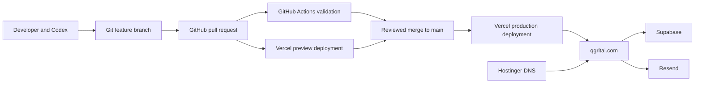

# QGRITAI Technology Stack and Delivery Operations

**Document status:** Current production implementation
**Last reviewed:** 1 August 2026
**Production site:** [https://qgritai.com](https://qgritai.com)

## 1. Purpose

This document records the technology used to build and operate the QGRITAI website, the external services connected to it, and the automated path from a code change to a verified production deployment.

It describes what is implemented today. Retained client-workspace capabilities are identified separately so they are not confused with the current public service offering.

## 2. System overview

QGRITAI is a Next.js application stored in a pnpm monorepo. GitHub is the source-of-truth repository. Pull requests trigger GitHub Actions and Vercel preview deployments. After an approved pull request is merged into `main`, Vercel builds and deploys the production application to `qgritai.com`.

Supabase provides PostgreSQL, authentication, tenant-aware authorization, and retained workspace data foundations. Resend delivers transactional email from a verified QGRITAI domain. Hostinger manages the domain and DNS records that connect the domain to Vercel and validate email delivery.



## 3. Application technology stack

| Layer | Technology | Current use |
|---|---|---|
| Web framework | Next.js 15, App Router | Public pages, server-rendered routes, Server Actions, API routes, metadata, sitemap, and robots configuration |
| User interface | React 19 | Reusable page and interactive UI components |
| Language | TypeScript in strict mode | Application, components, server logic, tests, and configuration |
| Styling | Custom CSS | Current responsive visual system, design tokens, layout, and component styling |
| Component package | `@qgritai/ui` workspace package | Shared presentational components across the monorepo |
| Icons | Lucide React | Consistent interface and marketing icons |
| Validation | Zod 4 | Environment configuration, authentication input, lead forms, assessments, ROI scenarios, and workspace mutations |
| Unit testing | Vitest 3 | Business calculations, environment validation, notifications, canonical URLs, and value reporting |
| Linting | ESLint 9 with Next.js configuration | Code quality and framework-aware lint checks |
| Package management | pnpm 9 workspace | Reproducible dependency installation and monorepo orchestration |
| Runtime | Node.js 20 in CI | Supported build and test runtime for automated validation |

Tailwind CSS is a possible future direction, but the production site currently uses the established custom CSS system. It should not be described as a Tailwind implementation today.

## 4. Repository structure

| Path | Responsibility |
|---|---|
| `apps/web` | Production Next.js website and retained application routes |
| `packages/ui` | Shared UI components |
| `supabase/migrations` | Version-controlled PostgreSQL schema and security changes |
| `supabase/tests/database` | pgTAP database and tenant-isolation tests |
| `.github/workflows/ci.yml` | Continuous integration workflow |
| `docs` | Product, architecture, deployment, roadmap, and operating documentation |

The repository is private-package-aware and uses one lockfile so local development, GitHub Actions, and Vercel resolve the same dependency graph.

## 5. Managed services

### GitHub

GitHub hosts `viswanthreddy/qgritai` and provides:

- the authoritative Git repository;
- feature branches and pull requests;
- reviewable change history and merge commits;
- GitHub Actions CI;
- commit-status integration with Vercel;
- auditable deployment promotion through merges to `main`.

The production website is not deployed directly from a developer laptop. Production promotion occurs by merging a validated pull request into `main`.

### Vercel

Vercel hosts the Next.js application and provides:

- automatic preview deployments for pull requests;
- automatic production deployments from `main`;
- server and API route execution;
- HTTPS and custom-domain delivery;
- production environment-variable storage;
- deployment logs and rollback to a previous known-good deployment;
- scheduled calls for protected background routes.

The Vercel project root is `apps/web`, with monorepo files outside that directory included so `packages/ui` remains available during builds.

Configured schedules in `apps/web/vercel.json` are:

- `/api/cron/notifications` at `02:00 UTC` daily;
- `/api/cron/document-scan` at `02:30 UTC` daily.

The notification job is active infrastructure. The document-scanning job is retained for a future private workspace and remains optional while document upload is outside the public launch scope.

### Supabase

Supabase provides:

- PostgreSQL 15;
- Supabase Auth and server-side session refresh;
- tenant-aware data access through PostgreSQL Row Level Security;
- migration-first database changes;
- public lead and readiness-assessment capture;
- retained organization, engagement, assessment, ROI, support, value-reporting, audit, and document foundations;
- local disposable Supabase services for database testing in CI.

Tenant-owned records use `organization_id` boundaries and Row Level Security policies. Public anonymous submission is exposed through narrowly scoped database functions; anonymous users do not receive direct read access to the leads table. The service-role key is restricted to trusted server operations.

### Resend

Resend provides transactional email delivery. The current notification pipeline uses:

- a PostgreSQL notification outbox;
- an authenticated Vercel cron route;
- atomic notification claiming;
- stable idempotency keys;
- bounded exponential retry state;
- Resend's HTTPS email API;
- a verified QGRITAI sending domain.

This design prevents a public form submission from depending directly on the email provider and avoids silently losing notification intent during a temporary provider failure.

### Hostinger and DNS

Hostinger manages the QGRITAI domain and DNS records. DNS connects `qgritai.com` to Vercel and contains the records required by Resend for domain verification and email authentication. Vercel terminates HTTPS and serves the website after DNS resolution.

### npm registry

The npm registry supplies versioned JavaScript dependencies and its audit service is used in CI to fail on known high-severity production dependency vulnerabilities.

## 6. Application and data security

Implemented controls include:

- strict TypeScript and schema validation for external input;
- environment-variable validation before provider clients are created;
- server-only handling of Supabase service credentials, Resend keys, and cron secrets;
- Supabase Row Level Security for tenant-owned data;
- role separation between organization membership and QGRITAI platform administration;
- protected cron routes using bearer authentication;
- security headers for HSTS, clickjacking protection, MIME sniffing, referrer policy, and browser permissions;
- non-persisted GitHub checkout credentials in CI;
- read-only GitHub Actions workflow permissions;
- bounded CI job timeouts;
- dependency overrides for known vulnerable dependency ranges;
- a no-cache production health endpoint that exposes safe booleans rather than secrets.

Important environment variables are stored in Vercel, not committed to Git:

```text
NEXT_PUBLIC_SITE_URL
NEXT_PUBLIC_SUPABASE_URL
NEXT_PUBLIC_SUPABASE_ANON_KEY
SUPABASE_SERVICE_ROLE_KEY
RESEND_API_KEY
EMAIL_FROM
CONTACT_NOTIFICATION_TO
CRON_SECRET
DOCUMENT_SCANNER_URL       # optional, private document workflow
DOCUMENT_SCANNER_SECRET    # optional, private document workflow
```

## 7. CI/CD automation

### Pull-request validation

Every pull request starts two independent GitHub Actions jobs.

The `validate` job:

1. checks out the repository without persisting credentials;
2. installs pnpm and Node.js 20;
3. installs dependencies with `--frozen-lockfile`;
4. runs strict TypeScript checking;
5. runs ESLint;
6. runs all Vitest tests;
7. creates an optimized Next.js production build;
8. audits production dependencies at high-severity level.

The `database` job:

1. installs the same pinned dependency graph;
2. starts a disposable local Supabase stack;
3. rebuilds the database from migrations and local seed data;
4. runs the pgTAP suite, currently including 39 tenant-access assertions;
5. runs the Supabase database linter at warning level;
6. always shuts down the disposable stack without retaining backup data.

Concurrency rules cancel superseded workflow runs for the same branch, avoiding wasted execution on obsolete commits.

### Preview deployment

The GitHub–Vercel integration detects a pull request commit and automatically:

1. builds the Next.js application;
2. creates an isolated preview URL;
3. reports deployment status on the GitHub commit and pull request;
4. updates the preview whenever the branch receives a new commit.

Preview deployment does not promote traffic to `qgritai.com`.

### Production deployment

The production release path is:

1. develop on a feature branch;
2. run local lint, typecheck, tests, build, and relevant visual checks;
3. push the branch and open a draft pull request;
4. wait for GitHub Actions and Vercel preview checks;
5. review the preview and approve the change;
6. mark the pull request ready and merge it into `main`;
7. allow Vercel to deploy the new `main` commit automatically;
8. confirm Vercel reports success;
9. smoke-test `qgritai.com` and `/api/health`.

The current health contract requires these checks to be true:

- canonical production site URL;
- Supabase public configuration;
- notification delivery configuration.

The document-scanner check is informational and may remain false while private document upload is not offered publicly.

## 8. How Codex was used

Codex acted as an engineering and release orchestration assistant throughout the project. Under user direction, it performed or supported:

- repository and documentation inspection;
- dependency installation and setup diagnosis;
- TypeScript, lint, test, build, and dependency-audit execution;
- implementation of public pages, forms, data foundations, security controls, and documentation;
- browser-based desktop and mobile visual verification;
- creation of feature branches and focused commits;
- draft pull-request creation and updates;
- monitoring GitHub Actions and Vercel deployment status;
- closing superseded pull requests while preserving their branches;
- merging an explicitly approved release into `main`;
- post-deployment health and live-route smoke testing.

Codex does **not** run continuously in production and is not the CI/CD engine. It operates interactively when authorized. GitHub Actions, Vercel, Vercel Cron, Supabase, and Resend provide the persistent automation after a Codex session ends.

This separation is deliberate: Codex accelerates engineering judgment and execution, while version control, CI policies, deployment integrations, environment isolation, and production observability remain the durable control system.

## 9. Rollback and recovery

Application rollback uses Vercel's deployment history to promote the last known-good production deployment. A reverted or corrective Git commit should then restore `main` to the intended source state.

Applied production database migrations are never deleted or rewritten. Database problems are corrected with a new reviewed forward migration. Secrets must be rotated in the owning service and updated in Vercel; they must never be added to the repository.

## 10. Current boundaries

The following foundations remain in the codebase but are not promoted as part of the current public website:

- public client-portal access;
- tenant workspace workflows;
- client document upload and malware scanning;
- full production authentication email delivery;
- recurring client reporting interfaces.

They can be enabled later only after the corresponding operational, security, and customer requirements are validated. The current production proposition remains a founder-led, agent-powered AI transformation services company.

## 11. Operating checklist

For every production release:

- [ ] No secrets or environment files are included in the diff.
- [ ] Typecheck, lint, unit tests, build, dependency audit, database tests, and database lint pass.
- [ ] The Vercel preview is reviewed at desktop and mobile widths.
- [ ] Public copy does not claim capabilities that are not operational.
- [ ] The pull request is explicitly approved before merge.
- [ ] Vercel reports the production deployment as successful.
- [ ] `https://qgritai.com/api/health` returns HTTP 200 and `status: "ok"`.
- [ ] Homepage, Services, About, Contact, and trust pages receive a live smoke test.
- [ ] Any production issue has an identified rollback or forward-fix path.
